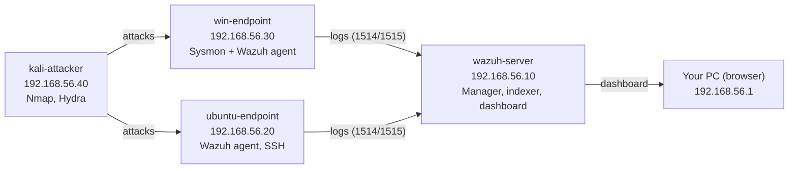

# SOC Lab Build Guide (VirtualBox + Wazuh)

Build a four-VM home SOC lab in VirtualBox: a Wazuh SIEM, a Windows and an Ubuntu endpoint that ship logs to it, and a Kali Linux attacker that generates real alerts to investigate.

## Table of contents

- [Lab overview](#lab-overview)
- [Step 0: Prerequisites and downloads](#step-0-prerequisites-and-downloads)
- [Step 1: Build the lab network](#step-1-build-the-lab-network)
- [Step 2: Create the Wazuh server VM](#step-2-create-the-wazuh-server-vm-ubuntu-server)
- [Step 3: Install Wazuh and open the dashboard](#step-3-install-wazuh-and-open-the-dashboard)
- [Step 4: Add the Ubuntu endpoint](#step-4-add-the-ubuntu-endpoint-with-a-wazuh-agent)
- [Step 5: Add the Windows endpoint](#step-5-add-the-windows-endpoint-with-sysmon-and-a-wazuh-agent)
- [Step 6: Set up the Kali attacker VM](#step-6-set-up-the-kali-attacker-vm)
- [Step 7: Run attacks and watch the alerts](#step-7-run-attacks-and-watch-the-alerts)
- [Step 8: Custom detection rules and MITRE ATT&CK](#step-8-write-custom-detection-rules-and-map-them-to-mitre-attck)
- [Step 9: Add Grafana for custom dashboards](#step-9-add-grafana-for-custom-dashboards)
- [Troubleshooting and good habits](#troubleshooting-and-good-habits)

---

## Lab overview

You will build four VMs on one isolated host-only network.

| Machine | Role |
| --- | --- |
| `wazuh-server` (Ubuntu Server) | Collects logs, runs detection rules, hosts the dashboard |
| `win-endpoint` (Windows 10 Pro) | The victim. Sysmon adds detailed process, network and file logs; the Wazuh agent ships them |
| `ubuntu-endpoint` (Ubuntu Server) | A Linux victim running SSH, so brute-force attacks show up |
| `kali-attacker` (Kali Linux) | Generates scans, brute-force attempts and attack simulations |

### Architecture



Host-only network: `192.168.56.0/24`. Each VM also has a NAT adapter for internet downloads (not drawn).

Kali attacks the two endpoints, their agents send logs to the Wazuh server on ports 1514 and 1515, and you read the alerts in the dashboard from your PC.

### VM sizing (16 GB laptop)

Wazuh's quickstart recommends 4 vCPU and 8 GB RAM for up to 25 agents. 4 GB and 2 CPUs is enough for this small lab, but the dashboard will feel slower. On an 8 GB laptop, build the Wazuh server and Windows VM first, give Windows 2 GB, and power on Kali or Ubuntu only when you need them. Disks are dynamically allocated, so they only use space as they fill.

| VM | RAM | CPUs | Disk (dynamic) |
| --- | --- | --- | --- |
| wazuh-server | 4 GB minimum, 8 GB recommended | 2 | 50 GB |
| win-endpoint | 4 GB | 2 | 70 GB |
| ubuntu-endpoint | 1 GB | 1 | 20 GB |
| kali-attacker | 2 GB | 2 | 30 GB |

### IP plan (used in every step)

| VM | Lab IP (host-only) | Internet |
| --- | --- | --- |
| Your host PC | 192.168.56.1 | n/a |
| wazuh-server | 192.168.56.10 | NAT adapter |
| ubuntu-endpoint | 192.168.56.20 | NAT adapter |
| win-endpoint | 192.168.56.30 | NAT adapter |
| kali-attacker | 192.168.56.40 | NAT adapter |

Every VM gets two network adapters: **Host-only** for lab traffic (your attacks stay inside it) and **NAT** for downloads. Step 1 shows exactly how to set both.

---

## Step 0: Prerequisites and downloads

Download everything first, because the ISOs are large (about 15 GB in total), and confirm virtualization is switched on.

### 1. Check virtualization is enabled

1. Press `Ctrl + Shift + Esc` to open Task Manager, then go to **Performance > CPU**.
2. Look for **Virtualization: Enabled**.
3. If it says Disabled, restart, enter BIOS/UEFI (usually F2, F10, Del or Esc), and enable Intel VT-x or AMD-V / SVM Mode. Save and reboot.
4. If VMs run very slowly later, turn off Hyper-V features: search **Turn Windows features on or off**, untick Hyper-V, Virtual Machine Platform and Windows Hypervisor Platform, then reboot.

### 2. Download these files

| What | Where | Notes |
| --- | --- | --- |
| VirtualBox + Extension Pack | [virtualbox.org/wiki/Downloads](https://www.virtualbox.org/wiki/Downloads) | Install VirtualBox, then double-click the Extension Pack to install it |
| Ubuntu Server 24.04 LTS ISO | [ubuntu.com/download/server](https://ubuntu.com/download/server) | Used for wazuh-server and ubuntu-endpoint |
| Kali Linux VirtualBox image | [kali.org/get-kali](https://www.kali.org/get-kali/) | Pick Virtual Machines, then VirtualBox 64-bit. It comes pre-installed, so no ISO setup |
| Windows 10 Pro ISO | [microsoft.com/software-download/windows10](https://www.microsoft.com/software-download/windows10) | Choose 64-bit, English, and pick the Pro edition during setup. It runs without activation for lab use (watermark, personalisation locked), or enter your own key |
| Sysmon | Sysinternals Sysmon | Downloaded inside the Windows VM later |
| Sysmon config | [SwiftOnSecurity/sysmon-config](https://github.com/SwiftOnSecurity/sysmon-config) | Download `sysmonconfig-export.xml` inside the Windows VM later |

### 3. Prepare your folders

Create `D:\SOC-Lab\ISOs` for downloads and `D:\SOC-Lab\VMs` for the virtual machines. Use any drive with at least 150 GB free; an SSD makes a big difference.

In VirtualBox, open **File > Preferences > General** and set **Default Machine Folder** to `D:\SOC-Lab\VMs`.

### 4. Keep it safe

> [!WARNING]
> - Run attacks only inside this lab network. Never point Kali at your home or college network, or at anyone else's machines.
> - Your Windows VM is deliberately weak. Keep the host-only network isolated, as set up in the next step.

---

## Step 1: Build the lab network

Create one host-only network (`192.168.56.0/24`) that only your PC and the VMs can see, then give every VM two adapters: NAT first for internet, host-only second for the lab.

### A. Create the host-only network

1. Open VirtualBox and go to **File > Tools > Network Manager** (in newer versions: **Tools > Network** in the left sidebar).
2. Open the **Host-only Networks** tab and click **Create**. A new network appears (for example `vboxnet0` or *VirtualBox Host-Only Ethernet Adapter*).
3. Select it and set the adapter manually: IPv4 Address `192.168.56.1`, IPv4 Network Mask `255.255.255.0`.
4. Leave the **DHCP Server disabled**, because every VM uses a fixed IP from the plan above.
5. Click **Apply**.

On Linux or macOS hosts, VirtualBox only allows host-only ranges inside `192.168.56.0/21` by default, so `192.168.56.0/24` works as is.

### B. Network settings for every VM

Open the VM's **Settings > Network** and set:

| Adapter | Attached to | Purpose |
| --- | --- | --- |
| Adapter 1 | NAT | Internet for downloads and updates; gives the default route |
| Adapter 2 | Host-only Adapter (the network you created) | Lab traffic with a static IP |

Tick **Enable Network Adapter** on both. Under **Advanced** for Adapter 2, leave Promiscuous Mode on **Deny**.

### C. Interface names inside each VM

| VM | Adapter 1 (NAT, DHCP) | Adapter 2 (host-only, static) |
| --- | --- | --- |
| Ubuntu Server | `enp0s3` | `enp0s8` |
| Kali | `eth0` | `eth1` |
| Windows | Ethernet | Ethernet 2 |

If your names differ, run `ip a` (Linux) or `ipconfig` (Windows) and use the interface that has no IP yet.

### D. Check it on your PC

Open Command Prompt and run `ipconfig`. You should see an adapter with `192.168.56.1`. If not, return to the Network Manager and re-apply the settings.

---

## Step 2: Create the Wazuh server VM (Ubuntu Server)

Build one Ubuntu Server 24.04 VM named `wazuh-server` with the static lab IP `192.168.56.10`. You will reuse the same steps for the Ubuntu endpoint later.

### A. Create the VM

1. In VirtualBox click **New**.
2. Name: `wazuh-server`. Folder: `D:\SOC-Lab\VMs`. ISO Image: pick the Ubuntu Server ISO. Tick **Skip Unattended Installation** so you control the install. Type should show Linux / Ubuntu (64-bit). Click Next.
3. Hardware: Base Memory 4096 MB (use 8192 if your laptop allows), Processors 2 (use 4 if you can). Click Next.
4. Virtual Hard Disk: create a new disk of 50 GB. Leave **Pre-Allocate Full Size** unticked. Click Next, then Finish.
5. Select the VM, click **Settings > Network** and apply the two-adapter setup from Step 1 (Adapter 1 NAT, Adapter 2 Host-only).
6. Click **Settings > System > Motherboard** and make sure **Optical** is above **Hard Disk** in the boot order.

### B. Install Ubuntu Server

Click **Start** and answer the installer as follows:

1. Language English, keyboard layout as per your keyboard.
2. Installation type: **Ubuntu Server** (not the minimized one).
3. Network connections: `enp0s3` should show a `10.0.2.x` address from DHCP. Select `enp0s8`, choose **Edit IPv4**, set method **Manual**, then enter: Subnet `192.168.56.0/24`, Address `192.168.56.10`, Gateway: leave empty, Name servers: leave empty.
4. Proxy: empty. Mirror: keep the default.
5. Storage: Use an entire disk with the defaults, then confirm Done and Continue.
6. Profile: your name, server name `wazuh-server`, username `soclab`, and a password you will remember.
7. Skip Ubuntu Pro. Tick **Install OpenSSH server**. Select no featured snaps.
8. Wait for the install, then choose **Reboot Now**. If it asks you to remove the installation medium, press Enter.

### C. First boot checks

Log in as `soclab`, then run:

```bash
ip a
ping -c 3 8.8.8.8
sudo apt update && sudo apt -y upgrade
sudo timedatectl set-timezone Asia/Kolkata
```

`ip a` must show `192.168.56.10` on `enp0s8` and a `10.0.2.x` address on `enp0s3`. The ping proves internet works through NAT. Setting the same timezone on every VM keeps log timestamps consistent when you investigate.

If `enp0s8` has no IP, set it by hand. Open the netplan file with `sudo nano /etc/netplan/50-cloud-init.yaml` (the file name can differ, so check with `ls /etc/netplan`) and make it look like this:

```yaml
network:
  version: 2
  ethernets:
    enp0s3:
      dhcp4: true
    enp0s8:
      dhcp4: false
      addresses: [192.168.56.10/24]
```

Then run `sudo netplan apply` and check `ip a` again.

### D. Connect from your PC

The VM console has no copy and paste. Instead, open PowerShell or Windows Terminal on your PC and run:

```bash
ssh soclab@192.168.56.10
```

Now you can paste commands straight from this guide. Do the same for the other Linux VMs.

### E. Take a snapshot

Shut down with `sudo poweroff`, then in VirtualBox choose **Machine > Take Snapshot** and name it `01-clean-ubuntu`. If anything breaks later, you can restore it in a minute.

---

## Step 3: Install Wazuh and open the dashboard

One command installs the Wazuh indexer, server and dashboard on `wazuh-server`; it takes about 10 to 20 minutes. The command below is from the [Wazuh quickstart](https://documentation.wazuh.com/current/quickstart.html), which used version 4.14 when this guide was written. Check that page if you want a newer version.

### A. Run the installer

Start `wazuh-server`, SSH in from your PC (`ssh soclab@192.168.56.10`), and run:

```bash
curl -sO https://packages.wazuh.com/4.14/wazuh-install.sh && sudo bash ./wazuh-install.sh -a
```

- `-a` means all-in-one: indexer, manager and dashboard on the same machine.
- If it stops with a message about minimum hardware (a 4 GB VM often reports slightly less than 4 GB), run the same command with `-i` added: `sudo bash ./wazuh-install.sh -a -i`.
- If it fails halfway, run `sudo bash ./wazuh-install.sh -u` to uninstall, then try again. You can also restore your `01-clean-ubuntu` snapshot.

When it finishes you will see a summary like this, with your own password:

```text
INFO: --- Summary ---
INFO: You can access the web interface https://<WAZUH_DASHBOARD_IP_ADDRESS>
    User: admin
    Password: <ADMIN_PASSWORD>
INFO: Installation finished.
```

Copy the password now. If you lose it, print all Wazuh passwords (run this in the same folder where you ran the installer):

```bash
sudo tar -O -xvf wazuh-install-files.tar wazuh-install-files/wazuh-passwords.txt
```

### B. Stop accidental upgrades

Wazuh recommends disabling its package repository after install, so a routine `apt upgrade` cannot break the stack:

```bash
sudo sed -i "s/^deb /#deb /" /etc/apt/sources.list.d/wazuh.list
sudo apt update
```

### C. Log in to the dashboard

1. On your PC, open a browser and go to `https://192.168.56.10`.
2. The browser warns about the certificate. This is expected for a lab: click **Advanced** and continue.
3. Log in with username `admin` and the password from the installer.
4. The first load can take a minute while the indexer starts.

### D. Check the services

If the page does not load, check each service on the server:

```bash
sudo systemctl status wazuh-manager wazuh-indexer wazuh-dashboard --no-pager
```

All three should say `active (running)`. Restart a stopped one with `sudo systemctl restart <name>`.

### E. Know what you are looking at

- **Endpoints Summary:** which agents are connected (none yet).
- **Threat Hunting / Events:** raw alerts you will search and filter.
- **MITRE ATT&CK:** alerts grouped by technique, useful for your write-ups.
- **Configuration Assessment (SCA):** how well each endpoint follows security benchmarks.

Shut down the VM cleanly (`sudo poweroff`) and take the snapshot `02-wazuh-installed`.

---

## Step 4: Add the Ubuntu endpoint with a Wazuh agent

This VM is a Linux victim with SSH exposed; once its agent shows **Active** in the dashboard, every login attempt on it becomes a searchable alert.

### A. Create the VM (repeat Step 2 with these changes)

| Setting | Value |
| --- | --- |
| VM name and server name | `ubuntu-endpoint` |
| RAM | 2048 MB for the install; you can lower it to 1024 later |
| CPUs | 1 |
| Disk | 20 GB |
| Adapter 1 / Adapter 2 | NAT / Host-only, as in Step 1 |
| Static IP on `enp0s8` | `192.168.56.20`, subnet `192.168.56.0/24`, no gateway |
| Username | `soclab` |

After the first boot, run `sudo apt update && sudo apt -y upgrade` and `sudo timedatectl set-timezone Asia/Kolkata`, then SSH in from your PC with `ssh soclab@192.168.56.20`.

### B. Install the agent (easiest: copy the command from the dashboard)

1. Make sure `wazuh-server` is running and you can open `https://192.168.56.10`.
2. In the dashboard open the main menu and go to the **Endpoints** (agents) page, then click **Deploy new agent**.
3. Pick **DEB amd64**, set the server address to `192.168.56.10`, set the agent name to `ubuntu-endpoint`, and leave the group as default.
4. Copy the command the wizard shows, paste it into the SSH session on `ubuntu-endpoint`, and run it. The wizard picks an agent version that matches your manager, which matters because an agent must not be newer than the manager.
5. Start the agent:

```bash
sudo systemctl daemon-reload
sudo systemctl enable wazuh-agent
sudo systemctl start wazuh-agent
```

<details>
<summary>Manual alternative (if the wizard command fails)</summary>

On the server, check the manager version with `sudo /var/ossec/bin/wazuh-control info`. Then on the endpoint:

```bash
sudo apt-get install -y gnupg apt-transport-https curl
curl -s https://packages.wazuh.com/key/GPG-KEY-WAZUH | \
  sudo gpg --no-default-keyring \
  --keyring gnupg-ring:/usr/share/keyrings/wazuh.gpg --import
sudo chmod 644 /usr/share/keyrings/wazuh.gpg
echo "deb [signed-by=/usr/share/keyrings/wazuh.gpg] \
https://packages.wazuh.com/4.x/apt/ stable main" | \
  sudo tee -a /etc/apt/sources.list.d/wazuh.list
sudo apt-get update
sudo WAZUH_MANAGER="192.168.56.10" WAZUH_AGENT_NAME="ubuntu-endpoint" \
  apt-get install -y wazuh-agent
sudo systemctl daemon-reload && sudo systemctl enable wazuh-agent
sudo systemctl start wazuh-agent
```

If the installed agent is newer than your manager, reinstall it pinned to the manager's version, for example `apt-get install wazuh-agent=<version>-1`, where `<version>` is what `wazuh-control info` printed.

</details>

### C. Keep the agent from upgrading itself

```bash
sudo sed -i "s/^deb /#deb /" /etc/apt/sources.list.d/wazuh.list
sudo apt-get update
```

### D. Verify the connection

- On the endpoint: `sudo tail -n 20 /var/ossec/logs/ossec.log` should include a line saying the agent connected to the server.
- On the server: `sudo /var/ossec/bin/agent_control -l` lists `ubuntu-endpoint` as Active.
- In the dashboard the Endpoints page shows 1 active agent.

If it stays disconnected, see [Troubleshooting](#troubleshooting-and-good-habits) for the port checks. Snapshot the VM as `01-agent-connected` once it works.

---

## Step 5: Add the Windows endpoint with Sysmon and a Wazuh agent

This is your main victim machine. Sysmon records every process start, network connection and file change in detail, and the Wazuh agent forwards those events, so most of your detections will come from here. This guide uses Windows 10 Pro: Pro can host Remote Desktop (needed for Attack 3) and lets you add Defender exclusions (needed for Attack 4).

### A. Create the VM

1. In VirtualBox click **New**. Name `win-endpoint`, pick the Windows 10 ISO, tick **Skip Unattended Installation**. Type Microsoft Windows, Version Windows 10 (64-bit).
2. Hardware: Base Memory 4096 MB, Processors 2. (Windows 11 only: also tick **Enable EFI**.)
3. Virtual Hard Disk: 70 GB (dynamic). (Windows 11 refuses to install on less than 64 GB.)
4. Open **Settings > System > Motherboard**. Keep Optical first in the boot order. (Windows 11 only: set TPM to v2.0.)
5. Open **Settings > Display** and set Video Memory to 128 MB.
6. Open **Settings > Network** and apply Adapter 1 NAT and Adapter 2 Host-only from Step 1.

### B. Install Windows

1. Start the VM and press any key when it says *Press any key to boot from CD or DVD*.
2. Choose language and keyboard, click **Install now**, and choose **I don't have a product key** (or enter your own Windows 10 Pro key).
3. Select **Windows 10 Pro** when asked for the edition, accept the licence, choose **Custom: Install Windows only**, select the empty disk, and wait for the restarts.
4. At setup, pick your region and keyboard. When asked to sign in, choose **Offline account** (or **Domain join instead**, if that is the option shown) to create a local account. On Windows 11 Pro, choose **Sign-in options > Domain join instead**.
5. Create the local user `labadmin` with a password you will remember. Turn off all privacy options.

### C. Install VirtualBox Guest Additions (copy and paste, screen size)

1. In the VM window choose **Devices > Insert Guest Additions CD image**.
2. Open This PC, double-click the CD drive, run `VBoxWindowsAdditions.exe`, accept the defaults, and reboot.
3. Choose **Devices > Shared Clipboard > Bidirectional** so you can paste commands into the VM.

### D. Set the static lab IP

Open PowerShell **as Administrator** and run:

```powershell
Get-NetAdapter
New-NetIPAddress -InterfaceAlias "Ethernet 2" -IPAddress 192.168.56.30 -PrefixLength 24
New-NetFirewallRule -DisplayName "Allow ICMPv4 In" -Protocol ICMPv4 -IcmpType 8 -Action Allow
ping 192.168.56.10
Test-NetConnection 192.168.56.10 -Port 1514
```

- Use the adapter name that `Get-NetAdapter` shows for the host-only adapter if it is not `Ethernet 2`.
- The firewall rule lets Kali ping this machine later.
- The ping should answer, and the port test should say `TcpTestSucceeded : True`. If not, check that `wazuh-server` is running.

### E. Install Sysmon with the SwiftOnSecurity config

In the same Administrator PowerShell window:

```powershell
mkdir C:\Tools\Sysmon
cd C:\Tools\Sysmon
Invoke-WebRequest -Uri https://download.sysinternals.com/files/Sysmon.zip -OutFile Sysmon.zip
Expand-Archive Sysmon.zip -DestinationPath .
$u = "https://raw.githubusercontent.com/SwiftOnSecurity/sysmon-config/master"
Invoke-WebRequest -Uri "$u/sysmonconfig-export.xml" -OutFile sysmonconfig-export.xml
.\Sysmon64.exe -accepteula -i sysmonconfig-export.xml
Get-Service Sysmon64
```

The service should show **Running**. To see its events, open **Event Viewer > Applications and Services Logs > Microsoft > Windows > Sysmon > Operational**; you should already see Event ID 1 (process creation) entries.

### F. Install the Wazuh agent

1. On your PC open the dashboard, go to the **Endpoints** page, and click **Deploy new agent**.
2. Pick **Windows (MSI 32/64 bits)**, set the server address to `192.168.56.10`, the agent name to `win-endpoint`, and keep the group default.
3. Copy the PowerShell command the wizard generates and run it in the Administrator PowerShell on the VM.
4. Start the agent:

```powershell
NET START WazuhSvc
```

If you prefer to type it yourself, replace `<version>` with your manager's version (shown by `sudo /var/ossec/bin/wazuh-control info` on the server):

```powershell
Invoke-WebRequest -OutFile $env:tmp\wazuh-agent.msi `
  -Uri https://packages.wazuh.com/4.x/windows/wazuh-agent-<version>-1.msi
msiexec.exe /i $env:tmp\wazuh-agent.msi /q WAZUH_MANAGER="192.168.56.10" `
  WAZUH_AGENT_NAME="win-endpoint"
NET START WazuhSvc
```

### G. Tell the agent to read Sysmon events

1. Open Notepad as Administrator (right-click, Run as administrator).
2. Open `C:\Program Files (x86)\ossec-agent\ossec.conf` (choose *All Files* in the open dialog).
3. Scroll to the end and paste this block just above the final `</ossec_config>` line:

```xml
<localfile>
  <location>Microsoft-Windows-Sysmon/Operational</location>
  <log_format>eventchannel</log_format>
</localfile>
```

4. Save the file, then restart the agent in PowerShell:

```powershell
Restart-Service -Name WazuhSvc
```

### H. Verify

- The Endpoints page shows `win-endpoint` as **Active**.
- On the VM open Notepad or run `whoami` in a terminal to create fresh activity.
- In the dashboard open **Threat Hunting**, select `win-endpoint`, and search `rule.groups: sysmon`. Sysmon alerts such as process creation should appear within a minute.

Take a snapshot called `01-win-agent-sysmon`. This is your clean Windows baseline to return to after destructive tests.

---

## Step 6: Set up the Kali attacker VM

Kali ships as a ready-made VirtualBox image, so there is no OS install: you import it, give it the lab IP `192.168.56.40`, and check it can reach every other VM.

### A. Import the image

1. Extract the Kali `.7z` file you downloaded using 7-Zip. You get a folder with a `.vbox` file and a `.vdi` disk.
2. Move that folder into `D:\SOC-Lab\VMs`.
3. In VirtualBox choose **Machine > Add**, and select the `.vbox` file.
4. Rename the VM to `kali-attacker` (right-click, Settings > General > Name).

### B. Adjust the hardware and network

1. **Settings > System:** Base Memory 2048 MB, Processors 2.
2. **Settings > Network:** Adapter 1 NAT, Adapter 2 Host-only (the lab network), as in Step 1.
3. Start the VM and log in with username `kali` and password `kali`.
4. Change the default password straight away:

```bash
passwd
```

### C. Give it the static lab IP

Open a terminal in Kali and run:

```bash
ip a
sudo nmcli connection add type ethernet ifname eth1 con-name labnet \
  ipv4.method manual ipv4.addresses 192.168.56.40/24
sudo nmcli connection up labnet
ip a show eth1
```

If your second interface is not `eth1`, use the name that `ip a` shows without an IP. The last command must show `192.168.56.40`.

### D. Update and prepare tools

```bash
sudo timedatectl set-timezone Asia/Kolkata
sudo apt update && sudo apt -y full-upgrade
sudo gunzip /usr/share/wordlists/rockyou.txt.gz
```

- The update can take 10 to 20 minutes the first time.
- `rockyou.txt` is the common-passwords list you will use for the brute-force test.
- `nmap` and `hydra` come preinstalled in the default Kali image. Check with `nmap --version` and `hydra -h`.

### E. Test that Kali can reach the lab

```bash
ping -c 3 192.168.56.10
ping -c 3 192.168.56.20
ping -c 3 192.168.56.30
```

All three should answer. If the Windows VM does not, check the firewall rule from Step 5 and that its host-only IP is set.

Take a snapshot called `01-kali-ready`. From now on, run attacks only against the `192.168.56.x` addresses.

---

## Step 7: Run attacks and watch the alerts

You will run four small attacks against your own lab VMs and look for each one in Wazuh. Some will alert straight away and some will not; the ones that do not are your detection gaps to write about.

Start all four VMs, confirm every agent is Active, and snapshot each VM first. Attack only the `192.168.56.x` machines.

| # | Attack | Run from | Target | What to look for |
| --- | --- | --- | --- | --- |
| 1 | Nmap scan | Kali | all lab VMs | Probably few alerts; SSH noise on the Ubuntu VM |
| 2 | SSH brute force (Hydra) | Kali | ubuntu-endpoint | Failed-login alerts, then a brute-force alert |
| 3 | Failed Windows logons (RDP) | Kali | win-endpoint | Event 4625 failed-logon alerts |
| 4 | Atomic Red Team tests | Windows | win-endpoint | Sysmon process and registry alerts |

### How to read an alert

In the dashboard open **Threat Hunting (Events)**, pick the agent, and set the time range to **Last 15 minutes**. Click the arrow on an alert and note `rule.id`, `rule.level`, `rule.description`, `rule.mitre.id`, `data.srcip` and `full_log`. These are the fields you will use in your notes and reports.

### Attack 1: Nmap scan

On Kali:

```bash
nmap -sn 192.168.56.0/24
nmap -sS -sV 192.168.56.20
nmap -A 192.168.56.30
```

The first command finds live hosts, the second finds open ports and service versions on Ubuntu, the third runs a deeper scan on Windows.

A host agent only sees what lands in logs, so a plain port scan is mostly invisible. Service probing against SSH can leave entries in `/var/log/auth.log` that trigger an alert about an insecure connection attempt. This gap is the reason real SOCs add a network sensor such as Suricata. Write down what you did and did not see.

### Attack 2: SSH brute force

On `ubuntu-endpoint`, create a target account with a weak password (lab only):

```bash
sudo useradd -m -s /bin/bash labuser
echo 'labuser:sunshine' | sudo chpasswd
```

On Kali, guess the password from the rockyou list:

```bash
hydra -l labuser -P /usr/share/wordlists/rockyou.txt -t 4 -f ssh://192.168.56.20
```

`-t 4` keeps four parallel tries so SSH does not drop the connections, and `-f` stops when the password is found.

In Wazuh, search `agent.name: ubuntu-endpoint` and `rule.groups: authentication_failures`. You should see repeated failed-login alerts, and after enough attempts a higher-level brute-force alert, with the Kali address `192.168.56.40` as `data.srcip`.

The final successful login also appears. A run of failures followed by a success from the same source is the classic sign of a brute force that worked. Check the MITRE field: this maps to technique **T1110, Brute Force**.

### Attack 3: Failed Windows logons

On the Windows VM, open **Settings > System > Remote Desktop** and switch it on (Windows 10 Pro supports this; Home does not). Then on Kali:

```bash
head -n 100 /usr/share/wordlists/rockyou.txt > ~/small.txt
hydra -l labadmin -P ~/small.txt -t 1 rdp://192.168.56.30
```

Hydra's RDP module can be unreliable, but failed logons are logged either way. On Windows check **Event Viewer > Windows Logs > Security** for Event ID 4625. In Wazuh search `agent.name: win-endpoint` and `data.win.system.eventID: 4625`. A burst of these from one source should raise a multiple-failures alert.

### Attack 4: Atomic Red Team on Windows

Atomic Red Team runs small, documented tests mapped to MITRE ATT&CK techniques, so you can trigger a specific technique on demand. **Snapshot the VM first.** Defender would otherwise delete the test files, so exclude the folder, then install. In Administrator PowerShell:

```powershell
Set-ExecutionPolicy Bypass -Scope CurrentUser -Force
Add-MpPreference -ExclusionPath "C:\AtomicRedTeam\"
$u = "https://raw.githubusercontent.com/redcanaryco/invoke-atomicredteam/master"
IEX (IWR "$u/install-atomicredteam.ps1" -UseBasicParsing)
Install-AtomicRedTeam -getAtomics
```

Then list and run tests, always listing first and cleaning up after:

```powershell
Import-Module "C:\AtomicRedTeam\invoke-atomicredteam\Invoke-AtomicRedTeam.psd1" -Force
Invoke-AtomicTest T1033 -ShowDetailsBrief
Invoke-AtomicTest T1033
Invoke-AtomicTest T1033 -Cleanup
```

Repeat for these low-risk techniques, picking one test number from the brief list each time:

| Technique | What it simulates | Test it for |
| --- | --- | --- |
| T1033 | System owner and user discovery | Commands like `whoami` in Sysmon process events |
| T1087.001 | Local account discovery | `net user` style enumeration |
| T1053.005 | Scheduled task creation | Persistence through a new task |
| T1136.001 | Creating a local account | New-user events and Sysmon activity |

For each test, wait a minute and search Wazuh for `agent.name: win-endpoint` over the last 15 minutes. If you find an alert, note its rule and MITRE ID. If you find only a raw Sysmon event with no alert, record that as a gap, which becomes a custom rule in the next step.

---

## Step 8: Write custom detection rules and map them to MITRE ATT&CK

Custom rules turn the gaps you found in Step 7 into alerts. You will add three rules to the Wazuh manager, test them, and tag each with a MITRE ATT&CK technique ID.

### A. Open the custom rules file

SSH to `wazuh-server` (`ssh soclab@192.168.56.10`) and run:

```bash
sudo nano /var/ossec/etc/rules/local_rules.xml
```

Custom rule IDs must be 100000 or higher. Paste the block below at the end of the file. The first two rules build on Wazuh's built-in Sysmon process-creation rule (61603). The third builds on the sshd rules you saw in Attack 2.

```xml
<group name="local,lab,">
  <rule id="100001" level="8">
    <if_sid>61603</if_sid>
    <field name="win.eventdata.image" type="pcre2">(?i)\\whoami\.exe$</field>
    <description>Recon: whoami.exe run on $(win.system.computer)</description>
    <mitre>
      <id>T1033</id>
    </mitre>
  </rule>

  <rule id="100002" level="12">
    <if_sid>61603</if_sid>
    <field name="win.eventdata.commandLine" type="pcre2">(?i)powershell.*\s-(e|enc|encodedcommand)\s</field>
    <description>PowerShell started with an encoded command on $(win.system.computer)</description>
    <mitre>
      <id>T1059.001</id>
    </mitre>
  </rule>

  <rule id="100003" level="14" timeframe="300">
    <if_sid>5715</if_sid>
    <if_matched_sid>5763</if_matched_sid>
    <same_source_ip />
    <description>SSH login succeeded after brute-force attempts from $(srcip)</description>
    <mitre>
      <id>T1110</id>
    </mitre>
  </rule>
</group>
```

Save with `Ctrl + O`, `Enter`, `Ctrl + X`.

### B. Check the syntax and load the rules

```bash
sudo /var/ossec/bin/wazuh-analysisd -t
sudo systemctl restart wazuh-manager
```

The first command prints nothing alarming if the XML is valid; an error names the line to fix. Rule 100003 uses the IDs 5715 (SSH success) and 5763 (SSH brute force) from your own Attack 2 alerts. If your alerts showed different `rule.id` values, use those instead.

### C. Test a rule without attacking

Wazuh ships a rule tester. Run `sudo /var/ossec/bin/wazuh-logtest`, paste this line, and press Enter:

```text
Nov 4 12:00:01 ubuntu-endpoint sshd[1234]: Failed password for labuser from 192.168.56.40 port 4444 ssh2
```

The output shows the three decoding phases and the rule that matched, which is how you learn why an alert fired. Press `Ctrl + C` to leave.

### D. Trigger each rule for real

| Rule | How to trigger it | Expected alert |
| --- | --- | --- |
| 100001 | On Windows run `whoami` in a terminal | Level 8, T1033 |
| 100002 | On Windows run `powershell -enc dwBoAG8AYQBtAGkA` (it only runs `whoami`) | Level 12, T1059.001 |
| 100003 | Repeat the Hydra attack, then log in with `ssh labuser@192.168.56.20` using the cracked password | Level 14, T1110 |

Find them in Threat Hunting with the query `rule.id: (100001 OR 100002 OR 100003)`. If one does not fire, open the matching raw event, compare its field names with the rule, and adjust the rule.

### E. Map detections to MITRE ATT&CK

| Technique | Tactic | Your detection | Evidence to capture |
| --- | --- | --- | --- |
| T1033 System Owner/User Discovery | Discovery | Rule 100001 | Alert screenshot, Sysmon event |
| T1059.001 PowerShell | Execution | Rule 100002 | Alert screenshot, command line |
| T1110 Brute Force | Credential Access | Built-in 5760/5763 and rule 100003 | Alert list, source IP |
| T1136.001 Create Account: Local | Persistence | Built-in Windows account rules | Event 4720 alert |

Open **MITRE ATT&CK** in the dashboard to see these techniques light up.

### F. Build a simple overview dashboard

1. Open the main menu and go to **Explore > Visualize**, then **Create visualization**.
2. Choose a type (for example Data table or Vertical bar) and the index pattern `wazuh-alerts-*`.
3. Make three: top `rule.description` values, alerts over time, and top `data.srcip` values.
4. Go to **Dashboards**, create a new dashboard named `SOC Lab Overview`, and add the three visualizations.

Menu names shift slightly between Wazuh versions, so if you cannot find an item, use the search box at the top of the menu.

---

## Step 9: Add Grafana for custom dashboards

Wazuh's own dashboard covers alert triage, but Grafana reads the same alert data out of the Wazuh indexer (OpenSearch) and makes it easy to build your own panels — alert trends, top source IPs, top triggered rules, and a MITRE technique breakdown, all in one view. This runs on `wazuh-server` alongside the rest of the stack.

> **RAM note:** Grafana adds roughly 200 to 300 MB. Fine on 4 GB or more, but 8 GB is more comfortable if you're running everything at once.

### A. Install Grafana

SSH to `wazuh-server` (`ssh soclab@192.168.56.10`) and run:

```bash
sudo apt-get install -y apt-transport-https software-properties-common wget
sudo mkdir -p /etc/apt/keyrings/
wget -q -O - https://apt.grafana.com/gpg.key | gpg --dearmor | sudo tee /etc/apt/keyrings/grafana.gpg > /dev/null
echo "deb [signed-by=/etc/apt/keyrings/grafana.gpg] https://apt.grafana.com stable main" | sudo tee /etc/apt/sources.list.d/grafana.list
sudo apt-get update
sudo apt-get install -y grafana
```

### B. Install the OpenSearch plugin

```bash
sudo grafana cli plugins install grafana-opensearch-datasource
sudo systemctl daemon-reload
sudo systemctl enable --now grafana-server
sudo systemctl restart grafana-server
```

Confirm it's running and listening:

```bash
sudo systemctl status grafana-server --no-pager
sudo ss -tlnp | grep 3000
```

If `ufw` is enabled, allow the port: `sudo ufw allow 3000/tcp`.

### C. Log in to Grafana

1. On your PC, go to `http://192.168.56.10:3000` (note the port, and `http`, not `https`).
2. Log in with `admin` / `admin`, then set a new password when prompted.

### D. Add the Wazuh indexer as a data source

1. Go to **Connections > Data sources > Add data source** and choose **OpenSearch**.
2. Set these values:

   | Field | Value |
   | --- | --- |
   | URL | `https://localhost:9200` |
   | Basic auth | On |
   | Skip TLS Verify | On (self-signed cert, lab only) |
   | User | `admin` |
   | Password | your Wazuh **indexer** password |
   | Index name | `wazuh-alerts-*` |
   | Pattern | Daily |
   | Time field name | `timestamp` |

   Use `localhost`, not the VM's IP, since Grafana and the indexer run on the same machine. The indexer password is printed by the Wazuh installer or recovered with:

   ```bash
   sudo tar -O -xvf wazuh-install-files.tar wazuh-install-files/wazuh-passwords.txt
   ```

   Sanity-check the password works before touching Grafana:

   ```bash
   curl -k -u admin:'<password>' https://localhost:9200
   ```

   A JSON response with `"cluster_name" : "wazuh-cluster"` confirms it's correct.

3. Click **Save & test**. You should see confirmation that the index and time field are OK.

### E. Build the dashboard

Click **Dashboards > New dashboard > Add visualization**, pick the OpenSearch data source, and build these panels. For each one: set the **Metric** to Count, add a **Group By**, pick a **visualization type** from *All visualizations*, and give it a title.

| Panel | Group By | Visualization | Notes |
| --- | --- | --- | --- |
| Alerts Over Time | Date Histogram on `@timestamp` | Time series | Shows alert volume over the selected time range |
| Top Triggered Rules | Terms on `rule.description` | Bar chart or table | Top 10, ranked by count |
| Top Source IPs | Terms on `data.srcip` | Table | Your Kali IP (`192.168.56.40`) should dominate during an attack |
| Alerts by Severity | Terms on `rule.level` | Pie chart | Shows the mix of alert severities |
| Custom Rule Hits | Lucene query `rule.id:(100001 OR 100002 OR 100003)`, no Group By | Stat | Confirms your Step 8 rules are firing |
| MITRE Techniques | Terms on `rule.mitre.id` | Bar chart | If empty, try `rule.mitre.id.keyword` |

If a Terms aggregation returns nothing, add `.keyword` to the field name — OpenSearch often needs the keyword subfield for exact-match aggregations (for example `data.srcip.keyword`).

### F. Save and verify

1. Click **Save** (top right), name the dashboard `SOC Lab Grafana Overview`.
2. Set the time range to **Last 1 hour** with auto-refresh **10s** so it updates live while you run attacks.
3. Rerun one of the Step 7 attacks and confirm the panels update.

### G. Export for the repo

Export the dashboard definition: gear icon (dashboard settings) **> JSON Model**, copy the contents, and save as `grafana/soc-lab-overview-dashboard.json` in your repo. Screenshot the full dashboard as `screenshots/grafana-overview-dashboard.png`.

> [!WARNING]
> Don't commit the indexer password or any credentials. Check the exported JSON and any screenshots for passwords before pushing, and rotate the indexer password if you've shared it anywhere outside your own machine.

---

## Troubleshooting and good habits

Most lab problems come from four things: the agent cannot reach the server, the agent version is newer than the manager, a VM is short of RAM, or a network adapter is set wrong. Check those first.

### Common problems

| Problem | Likely cause | Fix |
| --- | --- | --- |
| Dashboard will not load at `https://192.168.56.10` | Services still starting, or the VM has no host-only IP | Wait 3 to 5 minutes after boot. Run `ip a` on the server for `192.168.56.10`. Run `sudo systemctl status wazuh-manager wazuh-indexer wazuh-dashboard` |
| Agent shows *Never connected* or *Disconnected* | Agent cannot reach ports 1514 or 1515 on the server | Linux: `nc -zv 192.168.56.10 1514` and `nc -zv 192.168.56.10 1515`. Windows: `Test-NetConnection 192.168.56.10 -Port 1514`. If you enabled `ufw` on the server, run `sudo ufw allow 1514/tcp`, `sudo ufw allow 1515/tcp` and `sudo ufw allow 443/tcp` |
| Windows agent installed but never appears | The manager address was saved wrongly | Run `findstr "address" "C:\Program Files (x86)\ossec-agent\ossec.conf"`. If it shows `MANAGER_IP`, edit the file, put `192.168.56.10` between the address tags, and run `Restart-Service WazuhSvc` |
| Agent connects, then drops | Agent is a newer version than the manager | Reinstall the agent pinned to the manager's version (see Step 4) |
| Agent name already in use | An old registration with the same name exists | On the server run `sudo /var/ossec/bin/manage_agents -l`, then `sudo /var/ossec/bin/manage_agents -r <ID>`, and re-enroll |
| Wazuh installer fails | Too little RAM or a half-finished install | Give the VM 4 GB or more, run `sudo bash ./wazuh-install.sh -u`, then install again |
| Everything is very slow | Not enough RAM for all VMs at once | Run only the VMs you need. Shut down Kali when you are not attacking |
| A VM has no internet | Adapter 1 is not NAT or its cable is disconnected | Settings > Network, Adapter 1 Attached to NAT, open Advanced and tick **Cable Connected** |
| VM cannot ping your PC | Windows firewall on your PC blocks ping | Not a problem. VM to VM traffic is what matters |
| Windows 11 says it cannot run on this PC | Missing requirements | Use 4 GB RAM, 2 CPUs, 64 GB or more disk, Enable EFI and TPM v2.0, or use Windows 10 |
| Alert times look wrong | Different timezones across VMs | Set the same timezone on all VMs, as in the setup steps |

### Habits that save hours

- **Boot order:** start `wazuh-server` first and wait 3 to 5 minutes before the endpoints.
- **Snapshots:** take one before every attack session and after each working milestone. Restoring a snapshot is faster than repairing a VM.
- **Shut down cleanly:** use `sudo poweroff` and the Windows Shut down option; powering off a VM abruptly can corrupt the Wazuh indexer.
- **One change at a time:** change a rule or setting, test it, then change the next.
- **Keep a lab diary:** write the command, time and result as you go.
- **Stay isolated:** never move a VM onto a Bridged adapter while attack tools or weak accounts are on it.
